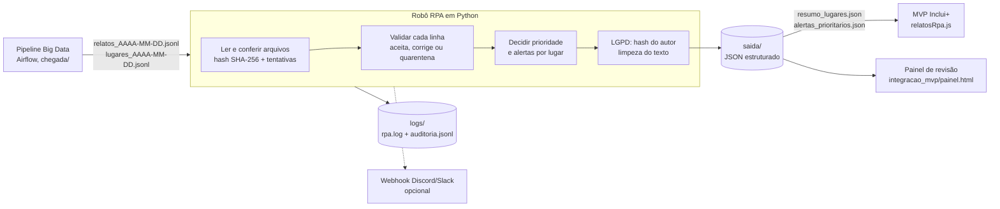
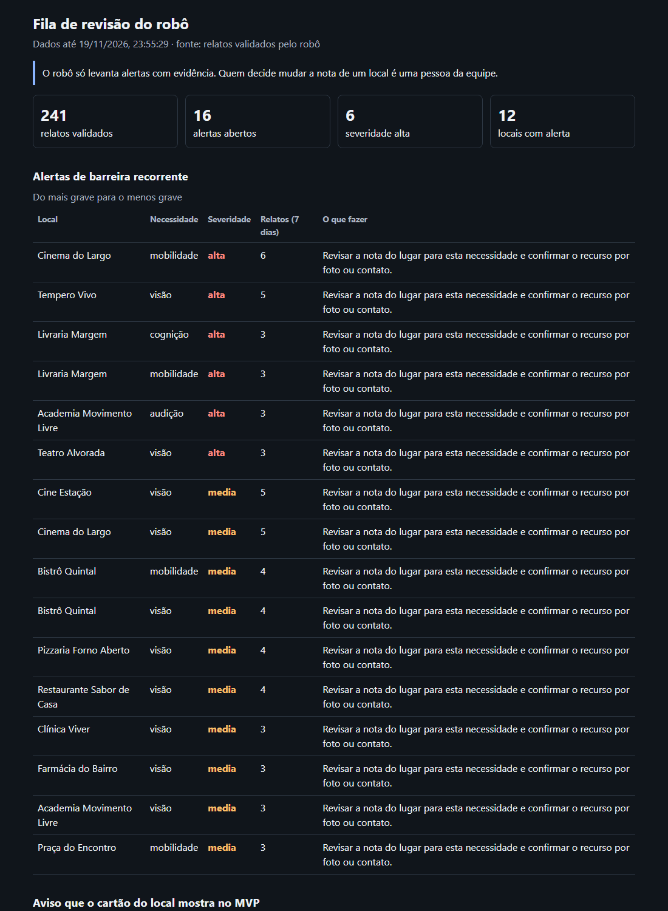

# GS RPA: robô de triagem de relatos do Inclui+

Componente **Robotic Process Automation** da Global Solution FIAP 2026.2 (CitizenTech, 4º ano de Engenharia de Software).
Produto da equipe: **Inclui+**, guia de lugares acessíveis em São Paulo com nota por necessidade (mobilidade, visão, audição e cognição).
Repositório do MVP: <https://github.com/kaikyalvaro1708/inclui-gs> · URL do MVP: <https://d3ls3zp8wqbtsw.cloudfront.net>

## Integrantes

| Nome completo | RM |
| --- | --- |
| Kaiky Alvaro de Miranda | RM98118 |
| Bruno Eduardo Caputo Paulino | RM558303 |
| Juan Pinheiro de França | RM552202 |
| Lucas Rodrigues da Silva | RM98344 |

Turma 4ESPW. Repositório: <https://github.com/JuanPinheiroFIAP/GS-RPA>. **Vídeo de demonstração (até 3 min):** [`video/demo_rpa.mp4`](https://github.com/JuanPinheiroFIAP/GS-RPA/blob/main/video/demo_rpa.mp4) (arquivo no repositório via Git LFS; no GitHub, clique em *Download* para assistir).

## O problema e o que o robô faz

Quem usa o Inclui+ envia relatos sobre os lugares ("não tinha rampa", "o cardápio em braile ajudou"). Esses relatos são a prova que
mantém as notas honestas, mas **alguém precisa conferi-los um a um**: tem nota inválida, lugar que não existe, relato repetido, arquivo
quebrado, e um relato de barreira fica perdido no meio de dezenas de elogios. Sem automação, o relato grave demora a virar ação, e a pessoa
com deficiência continua chegando a um local que o app diz ser acessível.

O robô faz essa triagem sozinho, todos os dias, e entrega ao MVP dados limpos e a fila do que a equipe precisa olhar primeiro:

1. **Lê** os relatos novos que o pipeline de Big Data deixa em `chegada/relatos/` (um `.jsonl` por dia) e o catálogo de lugares.
2. **Valida** cada linha: corrige o que dá para corrigir (` Vision` vira `vision`), manda o resto para a **quarentena** com o motivo.
3. **Decide** a prioridade de cada relato e levanta **alerta de barreira recorrente** quando um mesmo lugar acumula 3 ou mais relatos
   de barreira para a mesma necessidade em 7 dias.
4. **Protege** dados pessoais (LGPD): o autor vira um hash com sal, nome e e-mail nunca saem do robô, e e-mail/telefone/CPF digitados no texto são removidos.
5. **Entrega** ao MVP arquivos JSON estruturados e **audita** tudo em log.

O robô **não altera nota de lugar**. Ele só prioriza e levanta alertas com evidência; uma pessoa da equipe decide (pessoa no circuito).

## Arquitetura



Fluxograma BPMN completo: [`docs/fluxo_bpmn.svg`](docs/fluxo_bpmn.svg) e [`docs/fluxo_bpmn.bpmn`](docs/fluxo_bpmn.bpmn) (abre no bpmn.io). Mapeamento do processo (PDD): [`docs/PDD.md`](docs/PDD.md).

**Tecnologia: Python 3.12 só com a biblioteca padrão** (sem `pip install`). Justificativa: o processo é leitura de arquivos, regras e gravação de JSON,
que é exatamente o formato que o pipeline de Big Data já entrega; Python roda em qualquer máquina, agenda-se pelo Agendador de Tarefas/cron/Airflow e
é versionável e testável no Git. Nada de ferramenta de tela (UiPath) onde existe arquivo estruturado: é mais rápido, estável e auditável.

## Como reproduzir

Pré-requisito: Python 3.12 (Node 22+ só para o teste de integração com o MVP).

```bash
export PYTHONPATH=src                   # PowerShell: $env:PYTHONPATH = "src"
python -m rpa_relatos                   # processa tudo que for novo em dados/entrada/
python -m rpa_relatos --max-arquivos 3  # simula o lote 1 (3 arquivos); rode de novo para o lote 2
python -m rpa_relatos --reprocessar     # ignora o estado e refaz tudo
python scripts/demo.py                  # demonstração completa: sucesso, 2 lotes, reexecução e falhas
```

Os dados de exemplo em `dados/entrada/` são uma cópia dos arquivos que o pipeline de Big Data gerou em `chegada/` (relatos de 12 a 19/11/2026 e o catálogo
de lugares). Para ler direto do pipeline: `RPA_ENTRADA="../GS Big Data/chegada"` (precisa conter as pastas `relatos/` e `lugares/`).

### Configuração (variáveis de ambiente, ver [`.env.example`](.env.example))

| Variável | Para quê | Padrão |
| --- | --- | --- |
| `RPA_ENTRADA` | pasta com `relatos/` e `lugares/` | `dados/entrada` |
| `RPA_SAIDA` | onde o MVP lê o resultado | `saida` |
| `RPA_SAL_LGPD_SECRET` | sal do hash do autor (**segredo**, fora do código) | sal de desenvolvimento, com aviso no log |
| `RPA_WEBHOOK_URL_SECRET` | webhook do Discord/Slack (**segredo**) | vazio: o alerta só vai para log e arquivo |

Nenhuma chave, senha ou URL de webhook está no código ou no Git.

### Agendamento

O robô é idempotente: pode rodar a cada hora sem duplicar nada. Exemplos: cron `15 0 * * * cd /app && PYTHONPATH=src python -m rpa_relatos`; no Windows,
Agendador de Tarefas com a mesma linha; ou uma tarefa extra no DAG `gs_coleta` do Airflow, depois de `conferir_chegada`.

## Regras de negócio

**Validação de cada relato** (estrutura de decisão dentro de um laço sobre as linhas do arquivo):

| Situação | Decisão |
| --- | --- |
| Linha não é JSON, ou não é objeto | quarentena (`linha_json_invalida`, `registro_nao_e_objeto`) |
| Sem `relato_id`, sem data/hora, data inválida | quarentena (`relato_id_ausente`, `sem_data_hora`, `data_invalida`) |
| `lugar_id` fora do catálogo | quarentena (`lugar_inexistente`) |
| Necessidade fora de mobilidade/visão/audição/cognição, ou tipo fora de barreira/elogio | quarentena (`necessidade_invalida`, `tipo_invalido`) |
| Nota não numérica ou fora de 1 a 5 | quarentena (`nota_nao_numerica`, `nota_fora_da_faixa`) |
| Mesmo `relato_id` duas vezes | fica o primeiro; o repetido vai para a quarentena (`duplicado`) |
| `" Vision"`, nota `"4"`, data sem fuso | **corrige** e registra a correção (`necessidade_normalizada`, `nota_convertida_para_inteiro`, `fuso_assumido_brasilia`) |
| E-mail do autor inválido | aceita o relato, descarta a identificação (aviso `email_invalido_autor_descartado`) |

**Prioridade:** elogio = baixa · barreira com nota 1 ou 2 = alta · barreira nota 3 = média (alta se tiver 2 ou mais fotos) · barreira com nota 4 ou 5 = baixa (provável erro de preenchimento).

**Alerta de barreira recorrente:** 3 ou mais relatos de prioridade média/alta, do mesmo lugar e da mesma necessidade, em 7 dias. Severidade alta com 3 ou mais relatos de prioridade alta.
Todo alerta nasce `pendente_revisao`, com os ids dos relatos como evidência.

Os limites ficam em [`src/rpa_relatos/config.py`](src/rpa_relatos/config.py).

## Exceções e resiliência

| Falha | O que o robô faz |
| --- | --- |
| Arquivo travado por outro programa (leitura transitória) | repete até 3 vezes, com espera crescente, e registra cada tentativa |
| Arquivo vazio ou com codificação quebrada | registra a falha, **pula só aquele arquivo**, processa o resto e sai com código 1 (nunca "ok" falso) |
| Linha com JSON quebrado | vai para a quarentena; o resto do arquivo segue |
| Catálogo mais recente corrompido | cai para o catálogo anterior e registra qual usou |
| Sem nenhum catálogo ou sem pasta de relatos | falha fatal registrada (código 2): sem catálogo não dá para validar |
| Estado interno corrompido | reconstrói tudo a partir dos arquivos de entrada |
| Webhook fora do ar | 3 tentativas; depois guarda o aviso em `saida/notificacoes_pendentes.jsonl` e segue |
| Arquivo reeditado depois de processado | detecta pelo hash, substitui os relatos daquele arquivo (sem "relato fantasma") |
| Reexecução | nada duplica; a saída sai byte a byte igual |
| Erro inesperado | rede de segurança final: log com a pilha, evento de auditoria e código 2 |

Gravação **atômica** (arquivo temporário + troca): o MVP nunca lê um arquivo pela metade.

## Logs e auditoria

* [`logs/rpa.log`](logs/rpa.log): log legível com data/hora e nível. Amostra real em [`logs/`](logs/).
* [`logs/auditoria.jsonl`](logs/auditoria.jsonl): um evento JSON por passo (`inicio`, `catalogo_carregado`, `arquivo_processado`, `arquivo_com_falha`, `alertas_novos`, `fim`), com a execução, itens processados, sucessos e falhas.
* `saida/relatorio_execucao.json`: resumo da última execução (arquivos, linhas, aceitos, rejeitados por motivo, correções, prioridades, alertas).
* **Sem dado sensível**: a auditoria descarta por código qualquer campo `nome`, `email` ou `texto`, e há teste automático que falha se nome ou e-mail aparecerem em log ou saída.

## Integração com o MVP

O robô grava em `saida/` (contrato versão 1, JSON):

| Arquivo | Conteúdo | Quem consome |
| --- | --- | --- |
| `resumo_lugares.json` | por lugar e necessidade: relatos, nota média, barreiras, elogios e se há alerta | cartão do local no MVP |
| `alertas_prioritarios.json` | fila de revisão com severidade, relatos na janela, evidências e recomendação | equipe e painel |
| `relatos_validados.json` | relatos limpos, sem nome nem e-mail (autor só como hash) | MVP e Big Data (camada Bronze) |
| `quarentena.jsonl` | o que foi barrado e por quê (só id, linha e motivo) | auditoria |
| `relatorio_execucao.json` | números da última execução | monitoramento |

O MVP é um site estático (sem backend), então ele consome os JSON como arquivos publicados junto do site. O módulo
[`integracao_mvp/relatosRpa.js`](integracao_mvp/relatosRpa.js) (mesmo estilo de `site/assets/js/data/`) faz o resto:

```js
import { loadRpaData, placeNotice } from '../data/relatosRpa.js';
const rpa = await loadRpaData('./assets/data/');           // null se o robô ainda não rodou: o site segue normal
const aviso = placeNotice(rpa, place.id, needs);            // { level: 'alert' | 'info', message } ou null
```

Passo a passo para ligar no MVP: copiar `resumo_lugares.json` e `alertas_prioritarios.json` para `site/assets/data/`, copiar `relatosRpa.js` para `site/assets/js/data/` e chamar `placeNotice` no `placeCard.js`.
Para ver o resultado sem mexer no MVP, abra o **painel de revisão** (fila de alertas e a prévia do aviso do cartão do local):

```bash
python -m http.server 8000      # na raiz do repositório
# abrir http://localhost:8000/integracao_mvp/painel.html
```



## Testes e validação

```bash
PYTHONPATH=src python -m unittest discover -s tests -v     # 26 testes: sucesso, decisão e falha
node --test integracao_mvp/relatosRpa.test.js              # 6 testes de contrato com o MVP (rodar depois do robô)
```

| Cenário | Onde está |
| --- | --- |
| **Sucesso**: lotes, reexecução sem duplicar, saídas, LGPD, auditoria | [`tests/test_robo.py`](tests/test_robo.py) `TestSucesso` |
| **Decisão**: prioridade, alerta só com 3 relatos, janela de 7 dias, correção vs. rejeição | [`tests/test_validacao_decisao.py`](tests/test_validacao_decisao.py) |
| **Falha**: arquivo vazio/binário, linha quebrada, catálogo corrompido, sem catálogo, estado corrompido, leitura transitória, webhook fora do ar | [`tests/test_robo.py`](tests/test_robo.py) `TestFalhas` |
| **Integração**: o MVP lê o que o robô gravou, degrada sem arquivos, nenhum dado pessoal | [`integracao_mvp/relatosRpa.test.js`](integracao_mvp/relatosRpa.test.js) |

Evidências da execução real (`python scripts/demo.py`) em [`tests/evidencias/`](tests/evidencias/): saída dos testes, os 4 cenários e a integração.
Resultado dos dados reais: 7 arquivos, 258 linhas, **241 relatos aceitos, 17 na quarentena** (7 sem data/hora, 3 nota não numérica, 3 duplicados, 2 nota fora da faixa, 2 lugar inexistente),
prioridades 79 alta / 42 média / 120 baixa e **16 alertas** em 12 locais. Cenário de falha: 2 arquivos ruins pulados, resto processado, código de saída 1.

## Segurança e LGPD

* Credenciais (sal do hash, webhook) só por variável de ambiente; `.env` está no `.gitignore`.
* O relato chega com nome e e-mail sintéticos (`@example.com`); a saída **não tem nome nem e-mail**, só `autor_hash` (SHA-256 com sal, 16 caracteres).
* E-mail, telefone e CPF digitados no texto livre são removidos antes de gravar.
* Minimização: o robô guarda só o necessário para priorizar e mostrar no MVP. Logs têm ids e contagens, nunca texto de relato.
* Os dados deste repositório são simulados e documentados (ver o gerador em `relatos.py` do repositório de Big Data); conclusões sobre os relatos são ilustrativas.

## Conexão com os ODS

**ODS 10 (Redução das desigualdades)**, meta 10.2: inclusão de pessoas com deficiência; **ODS 11 (Cidades sustentáveis)**, meta 11.2 e 11.7: acesso seguro e inclusivo a espaços públicos;
**ODS 9**, meta 9.c/9.1: infraestrutura confiável com tecnologia; **ODS 3**, meta 3.8: acesso a serviços (clínicas, farmácias) sem barreira. O robô encurta o tempo entre
"alguém relatou a barreira" e "a nota do local foi revisada".

## Estrutura

```text
src/rpa_relatos/    código do robô (validacao, decisao, lgpd, arquivos, notifica, robo)
tests/              testes unitários e de ponta a ponta; evidencias/ com as saídas reais
integracao_mvp/     módulo JS do MVP, teste de contrato e painel de revisão
dados/entrada/      cópia dos arquivos do pipeline de Big Data (exemplo)
saida/              o que o MVP consome (gerado)
logs/               amostras de log e auditoria, sem dado sensível
docs/               PDD, fluxo BPMN (.bpmn e .svg), roteiro do vídeo
assets/             imagens e evidências visuais
scripts/            demo.py, gerar_bpmn.py
```
