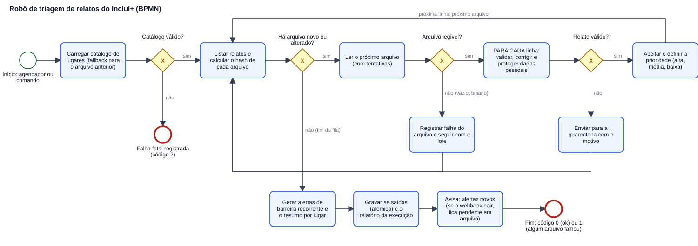

# PDD: Documento de Definição do Processo

**Processo:** triagem diária dos relatos de acessibilidade do Inclui+ · **Tipo:** automação de ponta a ponta, sem interface gráfica · **Versão:** 1.0

## 1. Visão geral

| Item | Descrição |
| --- | --- |
| Processo manual atual | Uma pessoa da equipe abre cada arquivo de relatos do dia, confere campo a campo, descarta o que está quebrado, procura relatos repetidos, lê os de barreira, decide quais lugares precisam de revisão e anota em uma planilha. |
| Volume | 30 a 45 relatos por dia (258 em 7 dias de coleta), crescendo com o uso do app. Cerca de 6% chegam com defeito. |
| Tempo manual estimado | cerca de 1 min por relato de barreira lido + conferência de campos: 40 a 60 min por dia. O robô leva menos de 1 s por execução. |
| Risco do manual | Esquecer um relato grave, contar duas vezes o mesmo relato, deixar dado pessoal (nome, e-mail) circular em planilhas. |
| Dono do processo | Equipe do Inclui+ (curadoria de dados). |
| Frequência | Diária, depois da coleta do pipeline de Big Data (DAG `gs_coleta`). |
| Gatilho | Agendador (cron, Agendador de Tarefas ou Airflow) ou comando `python -m rpa_relatos`. |

## 2. Entradas

| Entrada | Formato | Origem |
| --- | --- | --- |
| `relatos/relatos_AAAA-MM-DD.jsonl` | uma linha JSON por relato: `relato_id`, `criado_em`, `lugar_id`, `necessidade`, `tipo`, `nota`, `fotos`, `texto`, `autor_nome`, `autor_email` | pasta `chegada/` do pipeline de Big Data |
| `lugares/lugares_AAAA-MM-DD.jsonl` | uma linha JSON por lugar: `id`, `name`, `neighborhood`, `features`... | mesmo pipeline (catálogo do MVP) |
| Variáveis de ambiente | sal do hash e webhook (segredos) | cofre/`.env` fora do Git |

## 3. Etapas (passo a passo do robô)

| # | Etapa | Regra / decisão |
| --- | --- | --- |
| 1 | Carregar o catálogo de lugares | Usa o arquivo mais recente. **Decisão:** se estiver corrompido, usa o anterior. Se nenhum servir: falha fatal (código 2). |
| 2 | Listar `relatos_*.jsonl` e calcular o SHA-256 de cada um | **Decisão:** hash igual ao do estado = já processado, ignora. Hash novo ou diferente = processa (arquivo novo ou reeditado). |
| 3 | Ler o arquivo, com até 3 tentativas | **Exceção:** vazio ou codificação quebrada = registra a falha, pula o arquivo, segue o lote. |
| 4 | **Repetição:** para cada linha, validar | Tabela de validação abaixo. Aceita (corrigindo se preciso) ou envia à quarentena com o motivo. |
| 5 | Proteger dados pessoais | Autor vira `autor_hash` (SHA-256 com sal); nome e e-mail descartados; e-mail, telefone e CPF no texto são removidos. |
| 6 | Definir a prioridade de cada relato | Elogio: baixa. Barreira nota 1-2: alta. Nota 3: média (alta com 2+ fotos). Nota 4-5: baixa. |
| 7 | **Repetição:** agrupar por lugar e necessidade | **Decisão:** 3 ou mais relatos média/alta em 7 dias = alerta de barreira recorrente; severidade alta com 3 ou mais de prioridade alta. |
| 8 | Gravar as saídas de forma atômica | `relatos_validados`, `alertas_prioritarios`, `resumo_lugares`, `quarentena`, `relatorio_execucao`. |
| 9 | Avisar alertas novos | Webhook com 3 tentativas; se cair, `notificacoes_pendentes.jsonl`. Cada alerta é avisado uma vez. |
| 10 | Encerrar com código de saída | 0 = ok, 1 = algum arquivo falhou (parcial), 2 = falha fatal. |

### Validação de cada relato (ordem em que as regras são aplicadas)

`relato_id` presente → data/hora presente e válida → lugar existe no catálogo → necessidade em {mobility, vision, hearing, cognitive} (normaliza espaço e maiúscula) → tipo em {barreira, elogio} →
nota inteira de 1 a 5 (aceita `"4"` e converte) → e-mail do autor (inválido: descarta só a identificação) → texto sem dado pessoal e com no máximo 280 caracteres → duplicado (mesmo `relato_id`).

## 4. Saídas

`saida/resumo_lugares.json`, `saida/alertas_prioritarios.json`, `saida/relatos_validados.json`, `saida/quarentena.jsonl`, `saida/relatorio_execucao.json` e os logs em `logs/`.
Consumidor: MVP Inclui+ (módulo `integracao_mvp/relatosRpa.js`) e painel de revisão da equipe.

## 5. Exceções e tratamento

Ver a tabela "Exceções e resiliência" do [README](../README.md#exceções-e-resiliência). Princípio: **nenhuma falha é silenciosa**. Toda falha vira linha de log, evento de auditoria e, quando afeta o resultado, código de saída diferente de zero.

## 6. Papéis e pessoa no circuito

| Papel | Responsabilidade |
| --- | --- |
| Robô | Validar, priorizar, proteger, entregar e auditar. Nunca altera a nota de um lugar. |
| Equipe de curadoria | Revisar a fila de alertas (`pendente_revisao`), confirmar por foto ou contato e só então ajustar a nota. Revisar a quarentena quando o motivo indicar problema de origem. |

## 7. Indicadores do processo

Relatos lidos, aceitos e na quarentena por motivo; correções automáticas; alertas novos; tempo de execução; arquivos com falha. Todos em `saida/relatorio_execucao.json`.
Meta de impacto: reduzir o tempo entre o relato de uma barreira e a revisão da nota do local (hoje manual, de dias; com o robô, na mesma execução diária).

## 8. Fluxo

Arquivo editável: [`fluxo_bpmn.bpmn`](fluxo_bpmn.bpmn) (BPMN 2.0, abre no [bpmn.io](https://demo.bpmn.io)). Ambos são gerados por `python scripts/gerar_bpmn.py`.
